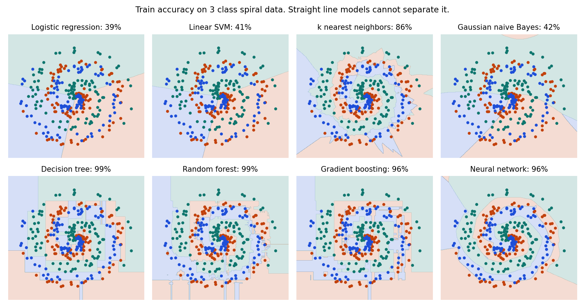
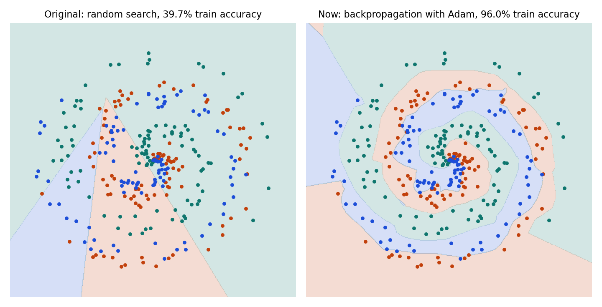

# Machine Learning and AI Algorithms from Scratch

Neural networks, classic machine learning and classic AI written in plain NumPy, then checked against scikit-learn and against numerical gradients. There are no deep learning frameworks anywhere in the library code.



## What's inside

| Module | Algorithms |
| :--- | :--- |
| [`scratchml/nn.py`](scratchml/nn.py) | Backpropagation, dense and convolution layers, max pooling, ReLU, tanh, dropout, batch normalization, L2, SGD with momentum, RMSProp, Adam |
| [`scratchml/supervised.py`](scratchml/supervised.py) | Ridge and linear regression, logistic regression, linear SVM (averaged Pegasos), k nearest neighbors, Gaussian naive Bayes, CART decision tree, random forest, gradient boosting |
| [`scratchml/unsupervised.py`](scratchml/unsupervised.py) | k means with k means++ seeding, PCA, Gaussian mixture with expectation maximization |
| [`scratchml/ai.py`](scratchml/ai.py) | A* search, minimax with alpha beta pruning, tabular Q learning |

## How it started

This repo began as a small network trained by random search: nudge the weights, keep the change if the loss improves. That code is still in [`original/`](original/). Replacing the training loop with backpropagation and Adam, on a slightly larger network, took 3 class spiral data from 39.7% to 96.0% train accuracy.



## Results

Accuracy with stratified 5 fold cross validation, from scratch / scikit-learn, using default style settings for both:

| Algorithm | Digits | Breast cancer | Wine |
| :--- | ---: | ---: | ---: |
| Logistic regression | 96.6% / 96.9% | 97.2% / 97.9% | 98.3% / 98.3% |
| Linear SVM | 95.0% / 95.6% | 96.7% / 96.8% | 97.8% / 98.3% |
| k nearest neighbors | 97.7% / 97.7% | 96.5% / 96.5% | 96.1% / 96.1% |
| Gaussian naive Bayes | 78.6% / 78.6% | 93.0% / 93.0% | 97.2% / 97.2% |
| Decision tree | 85.0% / 86.0% | 92.3% / 92.6% | 93.3% / 92.7% |
| Random forest | 97.4% / 97.3% | 95.6% / 96.5% | 98.3% / 97.2% |
| Gradient boosting | 96.6% / 96.5% | 96.5% / 96.5% | 94.9% / 94.9% |
| Neural network (MLP) | 97.8% / 97.7% | 97.2% / 97.7% | 96.6% / 98.3% |

Other checks:

* **CNN from scratch:** 98.4% (std 0.8%) on the 8x8 digits with 5 fold cross validation.
* **Ridge regression:** R² 0.420 on diabetes, equal to scikit-learn's 0.420, and coefficients match in the tests.
* **Clustering on iris:** adjusted Rand index of 0.620 for k means and 0.904 for the Gaussian mixture, both equal to scikit-learn.
* **Q learning:** finds the optimal 13 step cliff walking path on all 5 seeds.
* **Alpha beta:** evaluates tic tac toe as a draw and never loses to a random opponent across 50 games.

Plain NumPy is slower than scikit-learn's compiled code. Gradient boosting on digits takes about 4x as long, and random forest about 25x.

## How it's tested

The tests in [`tests/`](tests/) compare every hand written gradient with central finite differences, including convolution, pooling and the training mode path through batch normalization. Regression, PCA and clustering are compared directly with scikit-learn, and search and game playing are checked against known answers.

## Run it

```
pip install -r requirements-dev.txt
pytest
python -m benchmarks.run_benchmarks
```

```python
from scratchml.nn import Adam, Dense, ReLU, Sequential

model = Sequential([Dense(2, 64), ReLU(), Dense(64, 3)])
model.fit(X, y, Adam(0.01), epochs=200)
predictions = model.predict(X)
```

The library itself only needs NumPy. scikit-learn and Matplotlib are used for tests and benchmarks.
